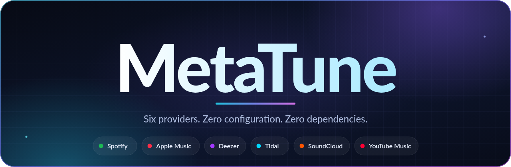

<p align="center">
  
</p>

<h1 align="center">MetaTune</h1>

<p align="center">
  <strong>Song metadata from Spotify, Deezer, Apple Music, Tidal, SoundCloud, and YouTube Music.</strong><br />
  Zero configuration. Zero dependencies. ESM + TypeScript.
</p>

<p align="center">
  <a href="https://www.npmjs.com/package/metatune"></a>
  <a href="https://www.npmjs.com/package/metatune"></a>
  <a href="https://github.com/iFluxo/MetaTune/blob/main/LICENSE"></a>
  <a href="https://github.com/iFluxo/MetaTune/actions/workflows/ci.yml"></a>
</p>

<p align="center">
  <a href="https://www.typescriptlang.org/"></a>
  <a href="https://bun.sh/"></a>
  <a href="https://deno.com/"></a>
  <a href="https://nodejs.org/"></a>
</p>

<p align="center">
  
  <a href="https://github.com/iFluxo/MetaTune"></a>
</p>

<p align="center">
  <a href="https://nodei.co/npm/metatune/"></a>
</p>

---

## Installation

```bash
# Bun
bun add metatune

# npm
npm install metatune

# Deno
deno add npm:metatune
```

## Usage

```ts
import {
  AppleMusic,
  Deezer,
  SoundCloud,
  Spotify,
  Tidal,
  YTMusic,
} from 'metatune';

// Search multiple tracks (default limit: 10)
const songs = await Spotify.search('The Weeknd', 5);

// Get the top matching track
const song = await Tidal.metadata('Blinding Lights');
```

Every provider exposes the same interface:

```ts
provider.search(query: string, limit?: number): Promise<SongMetadata[]>
provider.metadata(query: string): Promise<SongMetadata>
```

```ts
import type { SongMetadata } from 'metatune';

interface SongMetadata {
  provider: 'spotify' | 'deezer' | 'apple' | 'tidal' | 'soundcloud' | 'youtube';
  title: string;
  artist: string;
  album?: string;
  coverUrl?: string;
  url?: string;
  durationMs?: number;
  previewUrl?: string;
  raw?: Record<string, unknown>;
}
```

## Providers

| Export | Provider | Authentication |
| --- | --- | --- |
| `Spotify` | Spotify | Anonymous TOTP token generated automatically |
| `Deezer` | Deezer | None |
| `AppleMusic` | Apple Music | None |
| `Tidal` | Tidal | Public web player token |
| `SoundCloud` | SoundCloud | Public client ID resolved automatically |
| `YTMusic` | YouTube Music | None |

`Spotify.metadata()` accepts a track URL or ID:

```ts
await Spotify.metadata(
  'https://open.spotify.com/track/0VjIjW4GlUZAMYd2vXMi3b'
);
```

## Runtime support

| Runtime | Status |
| --- | --- |
| Bun | Supported |
| Deno | Supported |
| Node.js 22+ | Supported |
| Modern browsers | Supported through a bundler, subject to each service's CORS policy |

The library uses only standard APIs: `fetch`, `URLSearchParams`, `TextEncoder`, and `crypto.subtle`.

## Development

```bash
bun install
bun run typecheck
bun run demo
```

## License

MIT
